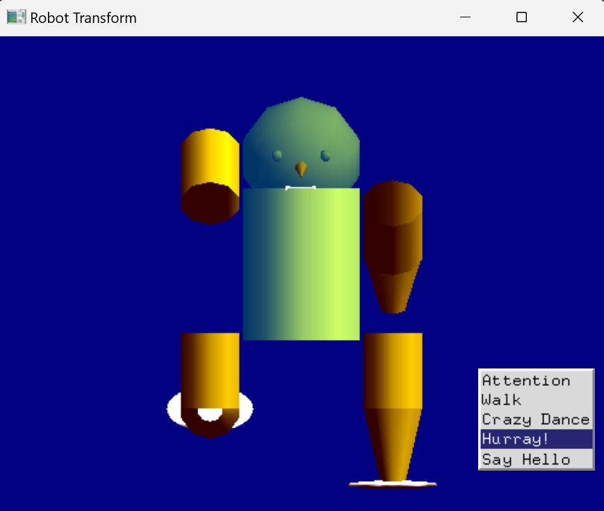
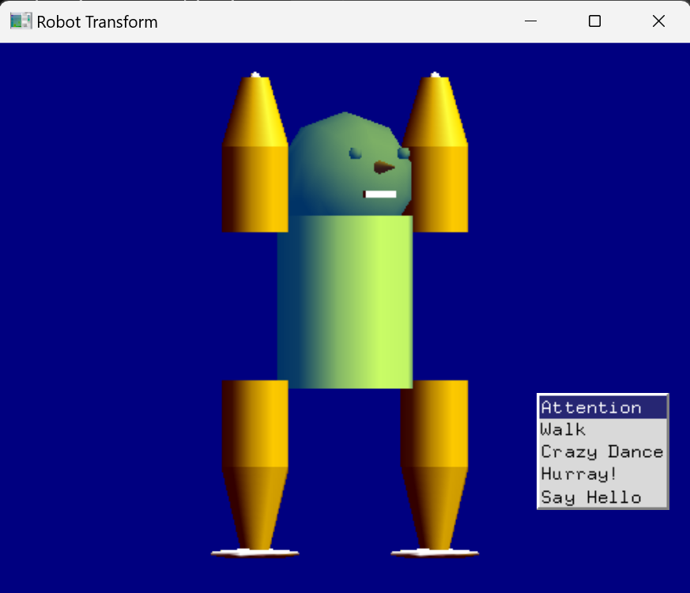
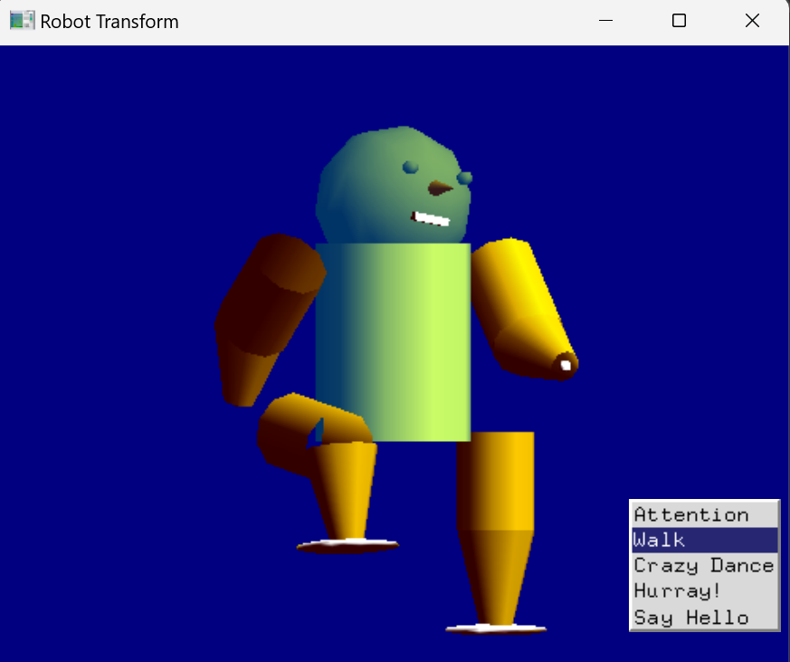
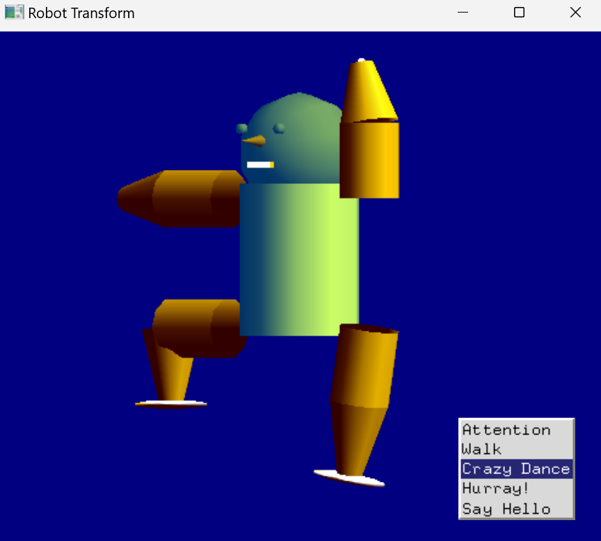
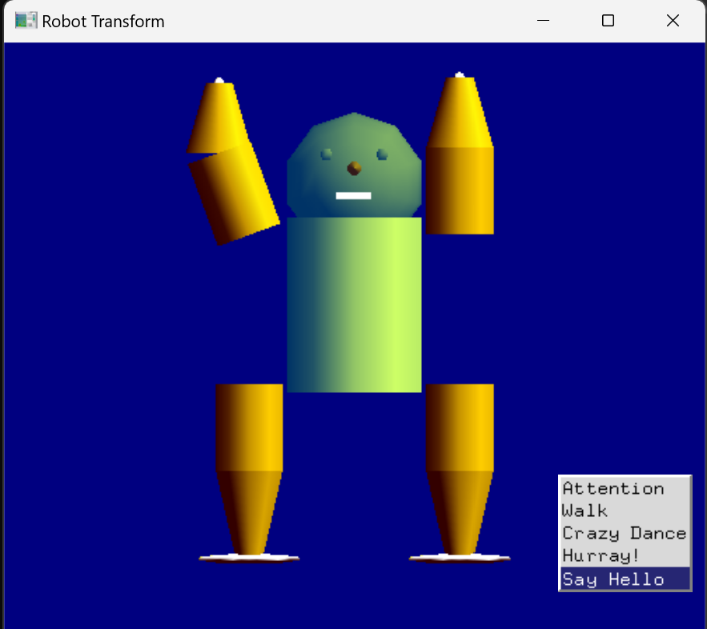

# Robot Transform

用 **C++ / OpenGL（GLUT）** 製作的 3D 階層式機器人動畫。機器人由頭、軀幹、上下手臂、上下腿等部件組成，每個關節都能獨立轉動；透過右鍵選單可以讓機器人立正、走路、跳舞、歡呼和揮手打招呼。



## 功能

| 動作 | 說明 |
|---|---|
| **Attention** | 回到立正姿勢，頭部恢復原本角度 |
| **Walk** | 手腳交替擺動走路 |
| **Crazy Dance** | 手腳快速揮舞的亂舞 |
| **Hurray!** | 手臂上下擺動、抬腿，頭部同時低頭抬頭的歡呼動作 |
| **Say Hello** | 舉起手臂來回揮動，向你打招呼 |

另外也可以先選擇單一部件，再用滑鼠點擊逐步調整該關節的角度，自己擺出任意姿勢。

## 操作方式

| 操作 | 功能 |
|---|---|
| 右鍵 | 開啟動作選單（Attention / Walk / Crazy Dance / Hurray! / Say Hello） |
| 中鍵 | 開啟部件選單，選擇要調整的關節（頭、軀幹、手臂、腿） |
| 左鍵點擊 | 將目前選擇的關節旋轉 5°（預設為頭部） |

> 建議依序選擇動作；若動作混在一起，重新執行程式即可。

## 實作重點

- **階層式模型（Hierarchical Model）**：以 `glPushMatrix()` / `glPopMatrix()` 串接軀幹 → 上臂 → 前臂、軀幹 → 大腿 → 小腿的座標轉換，父部件轉動時子部件會跟著移動。
- **關節角度陣列**：用 `theta[]`、`atheta[]` 記錄每個關節的角度，各動作只需設定不同的關節角度組合。
- **計時器動畫**：以 `glutTimerFunc()` 每 33 ms 更新一次畫面，依計數器切換關鍵姿勢，產生連續動作。
- **GLU / GLUT 幾何物件**：身體以 `gluCylinder()`、`gluSphere()` 組成，臉部的眼睛、鼻子（圓錐）、嘴巴（立方體）讓機器人更有表情。

## 執行畫面

| Attention | Walk |
|---|---|
|  |  |

| Crazy Dance | Say Hello |
|---|---|
|  |  |

## 編譯與執行

**Windows（Code::Blocks + freeglut）**：建立 GLUT 專案，加入 `src/main.cpp`，連結 `freeglut`、`opengl32`、`glu32` 後編譯執行。

**Linux**：

```bash
sudo apt install freeglut3-dev
g++ src/main.cpp -o robot -lglut -lGLU -lGL
./robot
```

## 說明

本專案以一份 OpenGL 階層式機器人範例程式（含立正、走路、跳舞動作與關節選單）為基礎延伸開發。我新增的部分包括：機器人的鼻子與嘴巴、Hurray! 歡呼動作、Say Hello 揮手動作，以及英文動作選單與畫面配色調整。
